<p align="center">
  
</p>

<h1 align="center">Game Curator</h1>

<p align="center">
  <b>Your games. Your archive. Your history.</b><br>
  A portable, offline archive for your DRM-free game collection, built for Windows.
</p>

<p align="center">
  
  
  
  
  
</p>

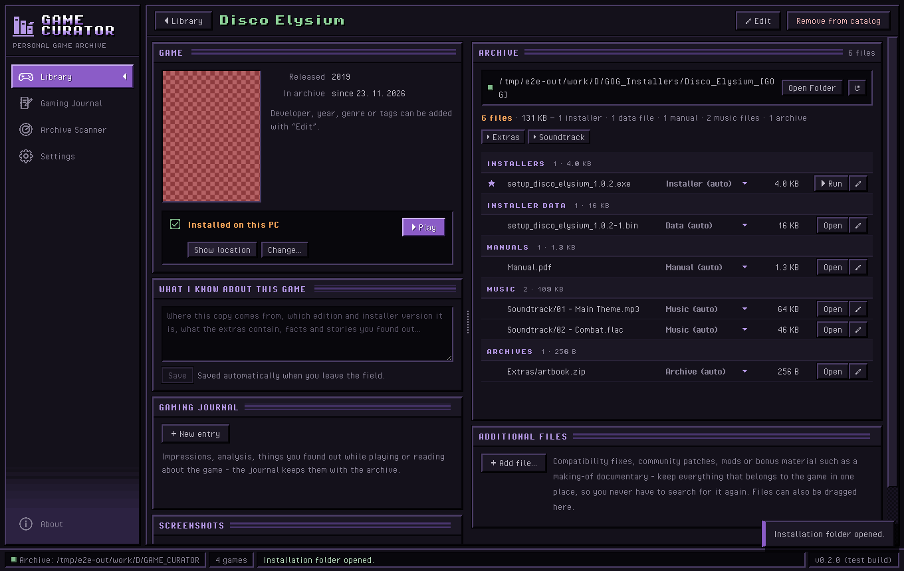

---

## Why Game Curator exists

As interest in DRM-free games grows, external drives fill up. Offline installers, patches, manuals,
soundtracks, artbooks and extras pile up over the years, until you no longer know what you have or where it is.

Game Curator is a quiet place to put it all in order. **It is an archive, not a backlog.**

* **No progress tracking.** There is no "unplayed", "completed", no ratings, no hours. Those numbers quietly
  push you to *finish* games. This app is about *knowing* them instead.
* **The curator's mindset.** Approach your collection like a video game archivist and researcher. Look closely
  at a game, find out how it was made, write down what you noticed and what you found out.
* **Slow gaming.** Games are made to be experienced slowly and attentively, with all their atmosphere.
  Racking up achievements or a big number of titles is not the point.
* **Focus as a skill.** Curating is also a quiet kind of training: in deep focus, in analysis, and in
  noticing the small details that make a game what it is.

> *Like the big boxes games used to come in, the archive is meant to be opened again: to look inside,
> remember, and add something.*

## Status: early preview, testers wanted

Version **0.1** is feature-complete for a first release, but **it has not yet been run on a real Windows
machine**. The Windows `.exe` is cross-compiled. Every feature is covered by automated tests: 38 core tests,
and 147 end-to-end checks that drive the real app through WebDriver on Linux, with native dialogs simulated.

The first real-world Windows runs are exactly what this project needs now.
See [How you can help](#how-you-can-help).

## Features

**Library**
* Cover grid (title, year, size on disk, "installed" checkbox, OFFLINE badge) or a compact catalog table.
* Search by title, ignoring diacritics ("zaklinac" finds "Zaklínač").
  Sort by title, year, size or date added.
* Deliberately **no filters**: you browse the archive as a whole.

**Game profile**
* **Game:** title, developer, publisher, year, genre, tags and artwork. A built-in crop editor lets you pan,
  zoom, fit or fill the cover in the 3:4 frame, and you can re-adjust it any time.
* **Installed on this PC:** detects games installed from GOG installers. It reads the GOG and Windows
  "installed programs" registry entries, read-only. **▶ Play** starts the game after a confirmation, and
  **Show location** opens its folder. If a game isn't detected, point to its `.exe` with **Locate…**.
  Installations are remembered per computer, because the drive travels and installations don't.
* **What I know about this game:** free notes on where your copy came from, installer versions, edition
  details, facts and stories you dug up.
* **Gaming Journal:** dated, formatted entries with gentle writing prompts. You can attach screenshots
  to an entry.
* **Screenshots:** the three newest at a glance, and a gallery with captions, arrow-key browsing and the
  Windows photo viewer.
* **Archive:** every file in the game's folder, grouped (installers, installer data, manuals, music,
  images, archives…), with Open, Run (after confirmation) and Open folder.
* **Additional files:** compatibility fixes, community patches, mods, bonus material such as a making-of
  documentary. **Copy** a file into the archive (it travels with the drive) or **link** it where it is.
* A resizable divider between the game column and the archive column.

**Elsewhere**
* **Gaming Journal page:** all entries from all games in one place, grouped by game.
* **Archive Scanner:** finds installer folders, reads titles from `goggame-*.info`, `title.txt` or folder
  names, and lets you review everything before import. It runs in the background, can be cancelled and
  never creates duplicates.
* **Drag & drop:** drop files from Explorer onto Screenshots, Additional files, the gallery or a journal
  entry.
* **Four looks:** *Classic* (dark, with a hint of GOG violet), *Terminal CRT Amber*, *Matrix Terminal* and
  *DOS Midnight* (MS-DOS text mode, a shade darker). Themes change only the look; controls stay the same.
* A welcome window that explains the idea, with "Don't show this again".

<details>
<summary><b>More screenshots</b></summary>

| | |
|---|---|
| 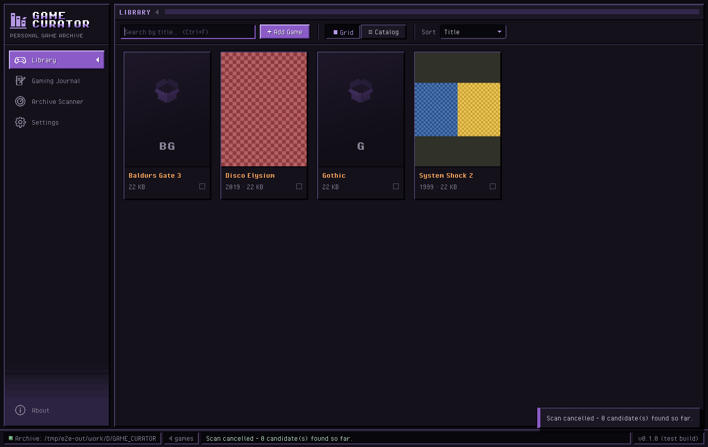 | 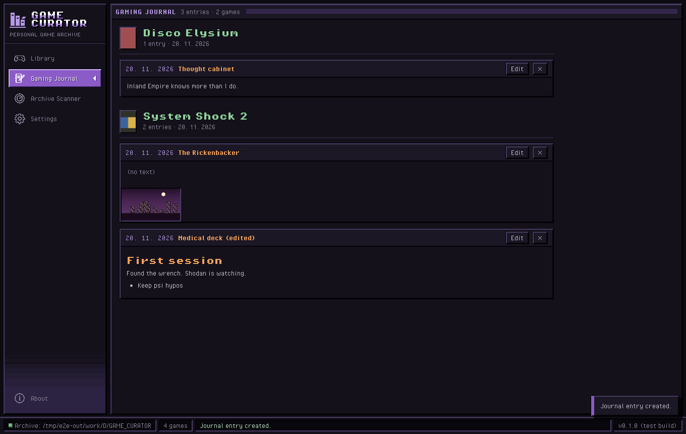 |
| 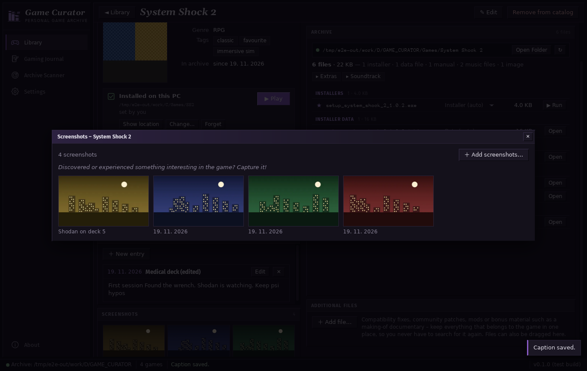 | 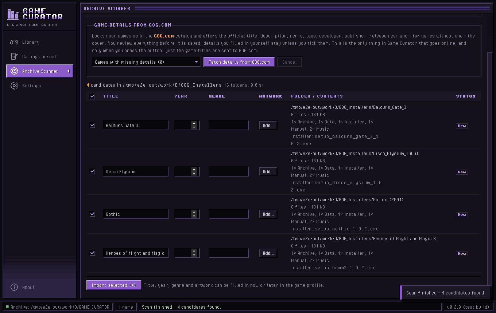 |
| 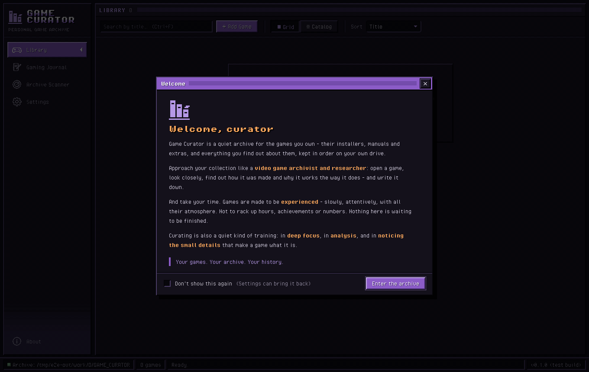 | 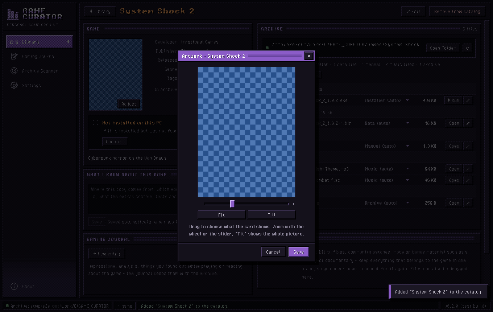 |
| 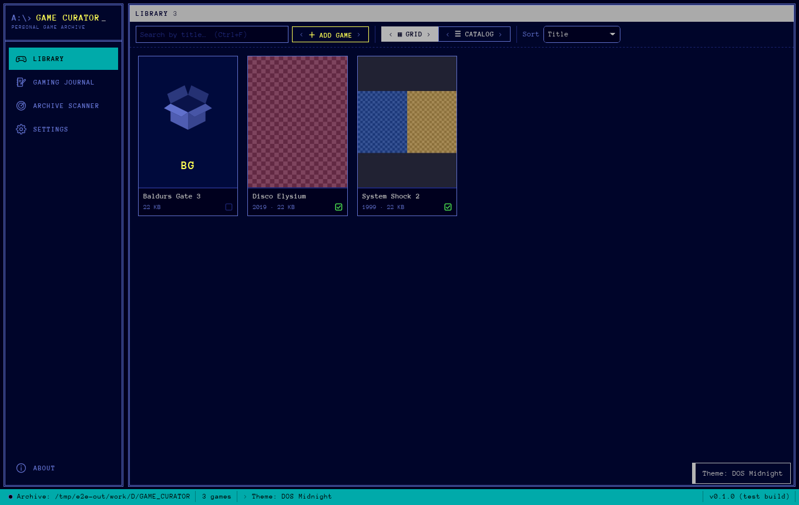 | 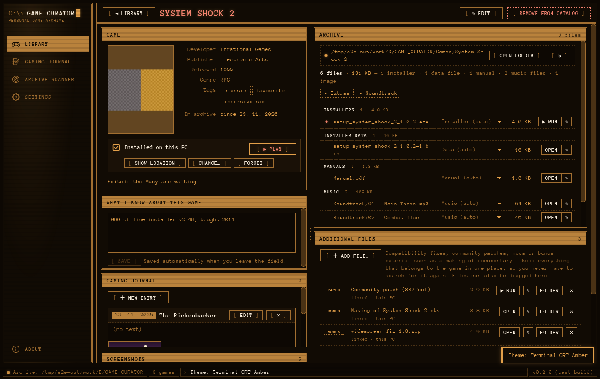 |
| 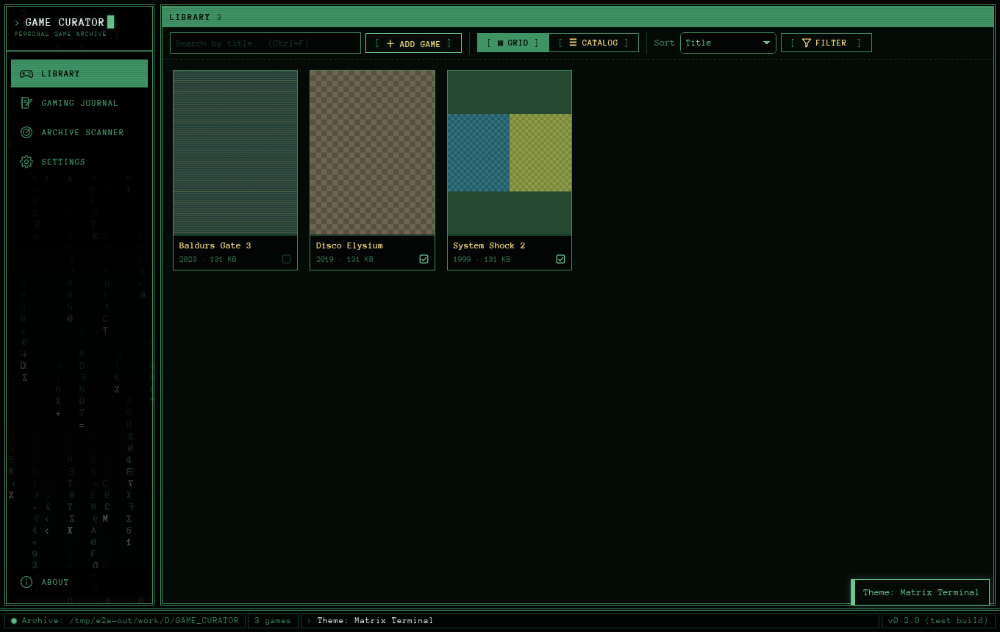 | 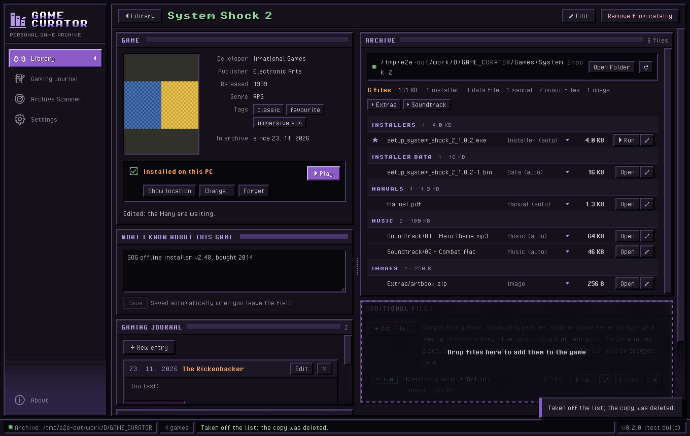 |

</details>

## Principles

| | |
|---|---|
| **Portable** | Everything lives next to the `.exe` in `Data/`, including the WebView2 profile. Paths are stored relative to the archive, so it keeps working after a drive letter change or on another PC. No installer, nothing in AppData, nothing written to the registry. |
| **Offline** | No accounts, no cloud, no telemetry, no update checks. WebView2 runs with its background networking switched off. Nothing keeps running after you close the window. |
| **Safe** | Game files are **never** deleted, moved or modified. Programs only start after a confirmation. A disconnected drive marks games as OFFLINE and never deletes them. The database is backed up daily and before every schema upgrade. |
| **Yours** | A plain SQLite database, readable HTML copies of every journal entry, backups in a folder you can see. |

## Getting started

1. Download `GameCurator-0.1.0-windows-portable.zip` from [Releases](../../releases).
2. Extract it to your games drive (an external drive is ideal).
3. Run `GAME_CURATOR\GameCurator.exe`, then add a game or let the Archive Scanner find your installer folders.

**Requirements:** Windows 10 or 11 (64-bit) with the Microsoft Edge **WebView2 Runtime**. Windows 11 and
updated Windows 10 already have it. Offline PCs can use the "Fixed Version" runtime in a `WebView2Runtime`
folder next to the `.exe`.

```text
GAME_CURATOR\
  GameCurator.exe        the app (~6 MB)
  WebView2Loader.dll     Microsoft's WebView2 loader (redistributable)
  .gamecurator-id        identifies this archive (don't delete)
  Data\
    library.db           the catalog (SQLite)
    config.json          settings
    Artwork\  Thumbnails\  Screenshots\  Additions\  Journals\  Backups\  WebView\
  Games\                 a suggested place for game folders (they can live anywhere on the drive)
```

## How you can help

Try it on your own archive and [open an issue](../../issues) with what you find. Most useful right now:

* **Does it start?** Windows version, display scaling (100 / 125 / 150 %), and the WebView2 version shown
  in **About**.
* **Archive Scanner** on a real GOG collection: were titles and installers recognised correctly?
* **Installed games:** were your GOG installs detected? Does **Play** start them, including DOSBox and
  ScummVM games?
* **Drag & drop** from Explorer, especially with display scaling: do files land in the right panel?
* **Portability:** move the drive to another PC or change its letter. Does everything still open?
* **Feel:** scrolling a large library, the themes, and anything that feels slow, confusing or unnecessary.

Ideas are welcome too. For example, a planned "Curators Guild" would let curators export and import their
notes, journal and artwork for a game as a file they can share.

## Building from source

**Windows (recommended):** install [Rust](https://rustup.rs) (MSVC toolchain) and the Visual Studio Build
Tools ("Desktop development with C++"), then run:

```powershell
cargo build --release -p game-curator     # -> target\release\GameCurator.exe (single file)
cargo test  -p curator-core               # core tests, run on any OS
```

No Node.js is needed: the UI is plain HTML/CSS/JS embedded into the `.exe` at compile time.
Cross-compiling from Linux (MinGW) and the end-to-end test harness are described in
[docs/BUILD.md](docs/BUILD.md).

## Project layout

```text
crates/curator-core/   GUI-free Rust core: catalog, file index, scanner, journal, screenshots,
                       additional files, installed games, images (WebP), backups, migrations
src-tauri/             Tauri 2 shell: commands, Windows APIs (ShellExecuteW, registry read),
                       gcimg:// protocol, drag & drop
ui/                    the interface: vanilla HTML/CSS/JS, themes
tests/e2e/             end-to-end tests (WebDriver)
docs/                  architecture, build, testing, known limitations
```

## Documentation

* [Architecture](docs/ARCHITECTURE.md), [database schema](docs/schema.sql), [build](docs/BUILD.md),
  [test results](docs/TESTING.md), [known limitations](docs/KNOWN_LIMITATIONS.md)
* [Česká verze README](docs/README.cs.md). The detailed docs are currently in Czech.

## License

*To be decided.* Until a license is added, all rights are reserved by the author.
`WebView2Loader.dll` is Microsoft's redistributable WebView2 loader.

---

Game Curator is an independent hobby project. It is not affiliated with or endorsed by GOG.com or
CD PROJEKT. GOG is a trademark of CD PROJEKT S.A., and MS-DOS is a trademark of Microsoft Corporation.
