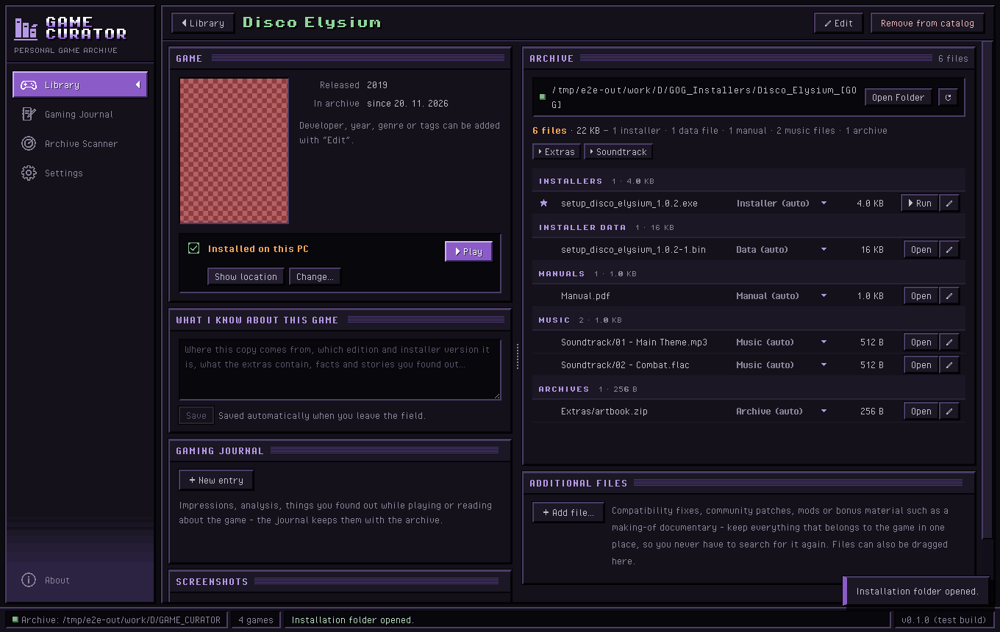
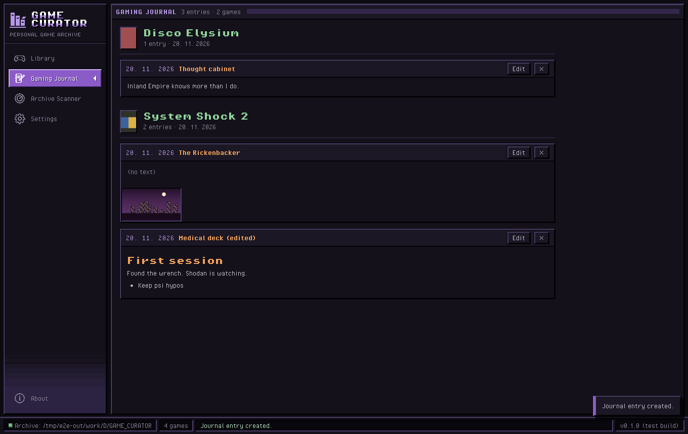
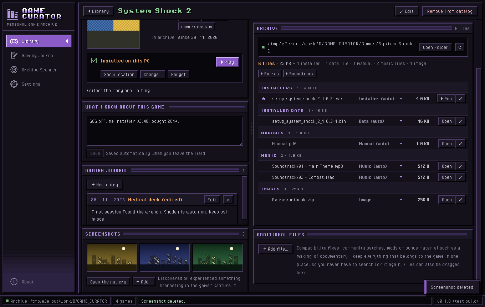
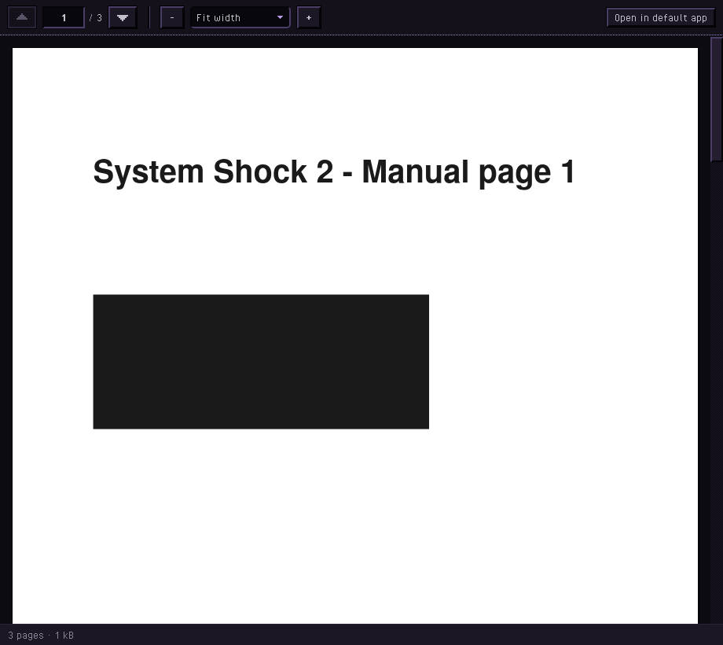
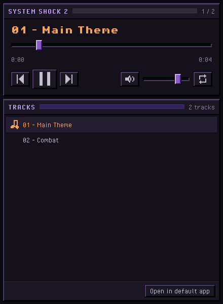

# Game Curator 0.1

**Your games. Your archive. Your history.**

Přenosná offline aplikace pro **Windows 10/11**, která drží v pořádku
archiv DRM-free her: instalační soubory, manuály, soundtracky a další
obsah, který ke hře patří (např. offline instalátory z GOG.com). Spouští se
přímo z externího disku, nic neinstaluje, nepotřebuje internet ani účty.

**Archiv, ne backlog.** Game Curator záměrně nesleduje, co je „dohrané“,
„rozehrané“ ani jak hru hodnotíte. Taková čísla nenápadně tlačí hry
dokončovat. Místo toho pomáhá vyznat se v úložišti s mnoha instalačními
soubory a podporuje kurátorskou práci: zapsat si dojmy, analýzu
a to, co jste o hře sami zjistili.

Stack: **Tauri 2 · Rust · HTML/CSS/vanilla JS · SQLite · WebP · WebView2**
(bez Electronu, bez frontendového frameworku, bez Node.js v buildu). Jen
Windows, `GameCurator.exe` má 7,2 MB (z toho ~1,1 MB čtečka PDF).







 

## Co umí

| Oblast | Funkce |
|---|---|
| **Menu** | jediné menu je levý sloupec s ikonami: Library (gamepad), Gaming Journal (zápisník s tužkou), Archive Scanner (radar), Settings (ozubené kolo), dole About („i“); horní lišta není |
| **Library** | mřížka obalů (název, rok, velikost na disku, OFFLINE, ikonka „nainstalováno“) a katalog (nainstalováno, rok, žánr, počet souborů, velikost, složka); hledání podle názvu bez ohledu na diakritiku; řazení podle názvu, roku, velikosti, data přidání. Záměrně **bez filtrů** – knihovna se prochází jako celý archiv |
| **Profil hry** | vlevo hra, „What I know about this game“ a deník, vpravo Archive se soubory; **dělicí čáru mezi nimi lze posunout** myší (nebo šipkami), šířka se pamatuje v `config.json`, dvojklik ji vrátí |
| **Archive** (profil hry) | soubory seskupené podle druhu (instalátory, data instalátorů, manuály, hudba, obrázky, archivy…) se souhrnem počtu a velikosti; podsložky jedním klikem v Průzkumníku; vlastní kategorie; hlavní instalátor; Open / Open Folder / Run s potvrzením; tužkou ✎ lze souboru dát **název v katalogu** – soubor na disku si nechá svůj název (ten je vidět v nápovědě) |
| **Manuály a hudba v programu** | Open u PDF otevře **okno čtečky** (stránky, zoom, na šířku / celá strana, klávesy; pdf.js, JavaScript z PDF se nikdy nespouští), Open u hudby (MP3, FLAC, OGG, WAV, M4A…) otevře **minimalistický přehrávač** se soundtrackem hry: přehrát/pauza, předchozí/další, posuvník, hlasitost, opakování, seznam skladeb, multimediální klávesy; obě okna mají „Open in default app“, v Settings > Manuals & music lze vše vrátit do výchozích programů Windows |
| **What I know about this game** | volné poznámky: původ kopie, edice, verze instalátoru, obsah extras, fakta a příběhy, které jste zjistili; ukládá se samo |
| **Screenshots** | pod deníkem: náhledy posledních 3 screenshotů a výzva „Discovered or experienced something interesting in the game? Capture it!“; galerie po rozkliknutí (velký obrázek, šipky, popisek, otevření v prohlížeči Windows, smazání); ukládají se optimalizované WebP kopie (do 3840 px, 4K zůstane 4K) v `Data/Screenshots`, originál se jen čte |
| **Additional files** | pod Archive: opravy kompatibility, komunitní patche, mody, bonusový materiál (třeba dokument o vývoji) – s druhem a poznámkou; soubor se buď **zkopíruje do archivu** (`Data/Additions`, cestuje s diskem), nebo se na něj jen **odkáže** tam, kde je; Open / Folder / ▶ Run (po potvrzení); tužka ✎ upraví název v katalogu, druh a poznámku |
| **Gaming Journal** | zápisky se píší v profilu každé hry a patří k ní (datum, formátování, nenápadné podněty k zamyšlení, **screenshoty k zápisku**); stránka Gaming Journal v menu je všechny shrnuje po hrách – nejnověji psaná hra nahoře, klik na hru otevře její profil; čitelné HTML kopie v `Data/Journals`; když skončí hra spuštěná přes **▶ Play**, Game Curator do sekundy nabídne zápis do deníku v malém okně, které je vždy navrchu – i když už jste přepnuli jinam (s volbou „Don't show this again“, zpět zapnout v Settings) – herní čas nikdy nepočítá ani neukazuje |
| **Add / Edit Game** | povinný jen název a složka; obal JPG/PNG/WebP → optimalizovaný WebP; **výřez obalu** přímo v programu (tažením posunout, kolečkem nebo posuvníkem přiblížit, Fit = celý obrázek, Fill = vyplnit rámeček), kdykoli později přes „Adjust“ v profilu; vývojář, vydavatel, rok, žánr, štítky, popis |
| **Nainstalované hry** | při startu se porovnají záznamy GOG a seznam programů Windows (jen čtení registru) s katalogem; ikonka zaškrtávátka na kartě, v katalogu i v profilu; v zobrazení Catalog mají nainstalované hry **vlastní ikonu** (z `goggame-*.ico` nebo z `.exe` hry, jen čtení; zarovnaná ve sloupci mezi stavem instalace a názvem); cesta k instalaci se nevypisuje (je v nápovědě), „Show location“ otevře složku instalace, **▶ Play** (přímo v rámečku „Installed on this PC“) spustí hru po potvrzení; nenalezenou hru lze ukázat ručně (Locate…); instalace se pamatují zvlášť pro každý počítač |
| **Archive Scanner** | najde složky s instalátory (i v podsložkách typu `installer`, `extras`), názvy z `goggame-*.info`, `title.txt` nebo složky; výběr a úprava před importem; běží na pozadí, lze zrušit; žádné duplicity |
| **Vzhledy** | Classic (spouštěč DOSových her z éry VGA: pixelové písmo, zkosená tlačítka, lišty s proužky, nádech fialové; text ve světle šedé, nadpisy a tučné písmo oranžové, názvy nainstalovaných her zelené; písmo lze v Settings přepnout: Pixel Operator, Dogica, Geist Pixel, Roboto Slab), Terminal CRT Amber (tlumená jantarová s teplou bílou a světle rudou), Matrix Terminal (tlumená zelená s bílou a žlutou), **DOS Midnight** (textový režim MS-DOS s písmem IBM VGA, o odstín tmavší) – mění se jen vzhled |
| **Uvítací okno** | při startu krátce přiblíží, o čem program je (přístup archiváře a badatele, hry si vychutnat, ne honit hodiny a achievementy; trénink soustředění a všímání si detailů); „Don't show this again“, zpět v Settings nebo z About |
| **Drag & drop** | soubory přetažené z Průzkumníka na Screenshots, Additional files, do galerie nebo do editoru zápisku se rovnou přidají |
| **Settings** | vzhled, uvítací okno, nabídka zápisu po dohrání, čtečka PDF a přehrávač, Grid/Catalog, velikost karet, složka pro skenování, kontrola dostupnosti, průvodce, zálohy a obnova |
| **About** | hlavní myšlenka projektu (s DRM-free hrami se plní externí disky; vyznat se v nich a v klidu se věnovat hobby vlastním tempem; archiv, ne backlog; herní historie si zaslouží pečlivé a láskyplné zacházení; přenosné, offline, bezpečné, vaše) a údaje o této kopii: verze, umístění archivu, počet her, ID archivu, databáze |
| **Přenositelnost** | všechna data v `Data/` vedle exe (i profil WebView2), cesty relativní ke kořeni archivu, `.gamecurator-id`, žádný registr ani AppData, nic neběží na pozadí, WebView2 bez síťových služeb |
| **Ochrana dat** | herní soubory se nikdy nemažou, nepřesouvají ani neupravují; potvrzení před smazáním i spuštěním; denní zálohy DB; záloha před každou úpravou schématu; odpojený disk = záznam označen, nikdy smazán |

Další screenshoty (z automatických E2E testů) jsou v [docs/screenshots](screenshots).

## Rychlý start

* **Uživatel:** rozbalte `GameCurator-0.1.0-windows-portable.zip` na externí
  disk a spusťte `GAME_CURATOR\GameCurator.exe`. Viz [portable/README.txt](../portable/README.txt).
* **Vývojář:** viz [docs/BUILD.md](BUILD.md).

```powershell
cargo test -p curator-core                       # 46 testů jádra
cargo build --release -p game-curator            # GameCurator.exe (Windows)
```

## Dokumentace

* [docs/ARCHITECTURE.md](ARCHITECTURE.md) – struktura projektu, vrstvy, přenositelnost, DB, skener, vzhledy, bezpečnost
* [docs/schema.sql](schema.sql) – databázové schéma SQLite (verze 5)
* [docs/BUILD.md](BUILD.md) – sestavení (Windows nativně, cross z Linuxu, testy)
* [docs/TESTING.md](TESTING.md) – výsledky testů a naměřené hodnoty
* [docs/KNOWN_LIMITATIONS.md](KNOWN_LIMITATIONS.md) – známá omezení a vědomé odchylky od zadání
* [portable/README.txt](../portable/README.txt) – návod pro uživatele (přikládá se k exe)
